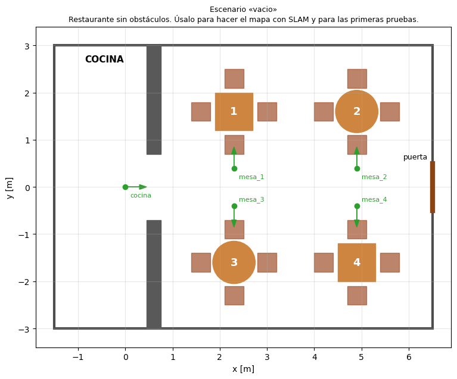

# Simulación del restaurante — ROSbot 2 PRO en Gazebo

**Autora:** Irene González

Simulación en **Gazebo Fortress** (ROS 2 **Humble**) de un restaurante con **4 mesas de 4 sillas y cocina**, para probar el código de navegación del equipo sin usar el robot real. Incluye **escenarios de prueba** con obstáculos estáticos imprevistos y personas que se cruzan en el camino del robot.

> **Relación con la simulación de Docker (`rosbot/sim/`, de Adri):** son dos simulaciones independientes que no comparten archivos. Esta se instala de forma nativa (sin Docker) y funciona en máquinas virtuales sin GPU. **Ojo:** su restaurante y sus waypoints son distintos de los de `rosbot/camarero/config/mesas_sim.yaml`. Para usar el nodo `camarero` con esta simulación, hay que pasarle un archivo de mesas generado con los waypoints de aquí (pendiente). Más adelante se empaquetará también en Docker para el resto del equipo.



## Contenido

| Ruta | Qué es |
|---|---|
| `restaurante_gazebo/config/restaurante.yaml` | Sala, cocina, mesas, sillas, paso de física y **catálogo de waypoints** mesa → `{x, y, yaw}` |
| `restaurante_gazebo/config/escenarios.yaml` | **Escenarios de prueba**: obstáculos estáticos y personas (ruta, velocidad, pausa) |
| `restaurante_gazebo/scripts/generar_mundo.py` | Genera `worlds/<escenario>.sdf` a partir de los dos YAML |
| `restaurante_gazebo/scripts/dibujar_plano.py` | Genera `docs/plano_<escenario>.png` |
| `restaurante_gazebo/scripts/personas_node.py` | Nodo que mueve a las personas por sus rutas |
| `restaurante_gazebo/scripts/verificar_simulacion.sh` | Comprueba los topics, sus frecuencias, el movimiento del robot y TF |
| `restaurante_gazebo/scripts/parar_simulacion.sh` | Para la simulación **sin dejar Gazebo huérfano** (ver más abajo) |
| `restaurante_gazebo/robot_config/` | Configuración del ROSbot: copia de la de Husarion **sin cámara** y con el **LiDAR RPLidar A2M12** del robot real |
| `restaurante_gazebo/config/gazebo_gui.config` | Ventana de Gazebo (motor `ogre`, compatible con VirtualBox, y Teleop en `/rosbot2r/cmd_vel`) |
| `restaurante_gazebo/config/restaurante.rviz` | RViz: láser, odometría, modelo del robot y mapa |
| `restaurante_gazebo/launch/restaurante.launch.py` | Arranca Gazebo, el ROSbot, el puente ROS↔Gazebo, las personas y RViz |
| `simulacion.repos` | Versión fijada del código de Husarion (`rosbot_ros`, rama humble) |
| `instalar_dependencias.sh` | Paquetes del sistema necesarios (requiere `sudo`) |

## Escenarios de prueba

| Escenario | Qué prueba | Plano |
|---|---|---|
| `vacio` | Restaurante limpio. **Úsalo para hacer el mapa con SLAM.** | [plano](restaurante_gazebo/docs/plano_vacio.png) |
| `obstaculos` | Silla movida, mochila y caja en los pasillos, que no están en el mapa. Todas las mesas siguen siendo alcanzables: Nav2 tiene que esquivarlos y replanificar. | [plano](restaurante_gazebo/docs/plano_obstaculos.png) |
| `mesa_bloqueada` | Un carrito ocupa el sitio de la mesa 4. **Nav2 debe fallar** al ir a `mesa_4` («objetivo no alcanzable», para el manejo de errores de Node-RED) y llegar bien al resto. | [plano](restaurante_gazebo/docs/plano_mesa_bloqueada.png) |
| `personas` | Una persona recorre el pasillo central de frente al robot y otra cruza el pasillo intermedio. | [plano](restaurante_gazebo/docs/plano_personas.png) |
| `hora_punta` | Cuatro personas a la vez (una de ellas, un camarero a 1 m/s) más obstáculos estáticos. Caso difícil. | [plano](restaurante_gazebo/docs/plano_hora_punta.png) |

En los planos, el **rojo** son obstáculos imprevistos, el **azul** las personas y sus rutas, y el **verde** los waypoints.

Para crear o cambiar escenarios, se edita `config/escenarios.yaml`. Cada persona tiene `velocidad` (m/s), `pausa` (s en cada extremo) y `ruta` (lista de puntos `[x, y]`, que recorre en ida y vuelta). Después se regeneran los mundos y los planos, y se recompila:
```bash
python3 restaurante_gazebo/scripts/generar_mundo.py
python3 restaurante_gazebo/scripts/dibujar_plano.py
```

## Coordenadas y waypoints

- El origen `(0, 0)` es la salida del robot en la cocina, mirando hacia `+x`.
- Si SLAM arranca con el robot ahí, el frame `map` coincide con el `world` de Gazebo, así que los waypoints de `restaurante.yaml` valen directamente para Nav2 (`NavigateToPose`).

| Destino | x | y | yaw |
|---|---|---|---|
| `cocina` | 0.0 | 0.0 | 0 |
| `mesa_1` | 2.3 | 0.4 | +π/2 |
| `mesa_2` | 4.9 | 0.4 | +π/2 |
| `mesa_3` | 2.3 | -0.4 | -π/2 |
| `mesa_4` | 4.9 | -0.4 | -π/2 |

## Instalación (una sola vez)

```bash
bash instalar_dependencias.sh            # requiere sudo
mkdir -p ~/ros2_ws/src && cd ~/ros2_ws    # o la ruta que prefieras
vcs import src < /ruta/a/PR2026/rosbot/sim/restaurante_nativo/simulacion.repos
vcs import src < src/rosbot_ros/rosbot/rosbot_simulation.repos
ln -s /ruta/a/PR2026/rosbot/sim/restaurante_nativo/restaurante_gazebo src/restaurante_gazebo
source /opt/ros/humble/setup.bash
export HUSARION_ROS_BUILD_TYPE=simulation
MAKEFLAGS=-j2 colcon build --symlink-install --parallel-workers 1 --cmake-args -DCMAKE_BUILD_TYPE=Release
```

## Ejecución

```bash
source ~/ros2_ws/install/setup.bash
ros2 launch restaurante_gazebo restaurante.launch.py escenario:=personas
```

| Argumento | Por defecto | Para qué |
|---|---|---|
| `escenario` | `vacio` | `vacio`, `obstaculos`, `mesa_bloqueada`, `personas`, `hora_punta` |
| `namespace` | `rosbot2r` | El mismo que el robot real |
| `rviz` | `True` | Abrir RViz2 |
| `headless` | `False` | Gazebo sin ventana (más ligero). Recomendado en VirtualBox: se mira la simulación en RViz |
| `software_gl` | `True` | OpenGL por software para Gazebo. **Necesario en VirtualBox**, porque si no el LiDAR no detecta nada (ERR-010). En un equipo con GPU real: `False` |
| `x`, `y`, `yaw` | `0`, `0`, `0` | Pose inicial del robot |

> ⚠️ **Para parar, usa siempre el script de parada.** Al cerrar el launch con Ctrl+C, el servidor de Gazebo puede quedarse vivo en segundo plano. Si luego se relanza, el robot se conecta a ese servidor viejo y falla la carga de controladores (`Failed to configure controller`).
> ```bash
> bash restaurante_gazebo/scripts/parar_simulacion.sh
> ```

Para teleoperar el robot:
```bash
ros2 run teleop_twist_keyboard teleop_twist_keyboard --ros-args -r cmd_vel:=/rosbot2r/cmd_vel
```

Para comprobar que todo funciona (con la simulación lanzada):
```bash
bash restaurante_gazebo/scripts/verificar_simulacion.sh
```

## Interfaz para el código del equipo

Verificado con `verificar_simulacion.sh` el 2026-11-05:

| Topic / acción | Tipo | Sentido | ¿Igual que el robot real? |
|---|---|---|---|
| `/rosbot2r/cmd_vel` | `geometry_msgs/Twist` | entrada | ✅ |
| `/rosbot2r/scan` | `sensor_msgs/LaserScan` | salida | ✅ |
| `/rosbot2r/odometry/filtered` | `nav_msgs/Odometry` | salida | ✅ |
| `/rosbot2r/imu/data` | `sensor_msgs/Imu` | salida | ⚠️ En el robot real (`rosbot_ros` 0.13.1) se llama `/rosbot2r/imu_broadcaster/imu`. Nav2 no la usa directamente |
| `/clock` | `rosgraph_msgs/Clock` | salida | Solo en simulación: los nodos deben usar `use_sim_time:=True` |

## Velocidad del robot

Valores de la configuración oficial de Husarion que usa el equipo (`rosbot-autonomy/config/nav2_dwb_params.yaml`):

| Concepto | Lineal | Angular |
|---|---|---|
| Máximo **medido** del ROSbot (comentario de Husarion) | 1.0 m/s | 3.14 rad/s |
| Límite del `velocity_smoother` de Nav2 | 0.5 m/s | 1.5 rad/s |
| Máximo del planificador local DWB (`max_vel_x`, `max_vel_theta`) | 0.4 m/s | 1.0 rad/s |
| Radio del robot para Nav2 (`robot_radius`) | 0.16 m | — |

En la simulación se usan los mismos límites, porque los pone Nav2 y no Gazebo. Para las primeras pruebas con carga en el robot real, conviene bajarlos.

## Rendimiento

En el portátil de pruebas (máquina virtual con 2 núcleos, 5 GB de RAM y sin GPU), el factor de tiempo real es de **≈ 0,7** sin ventanas, **≈ 0,35** con RViz y **≈ 0,05** con la ventana de Gazebo. Para trabajar se recomienda `headless:=True` y mirar la simulación en RViz. Los resultados son válidos, porque todos los nodos usan `use_sim_time`, pero las pruebas tardan más. En un equipo con GPU irá a tiempo real.
